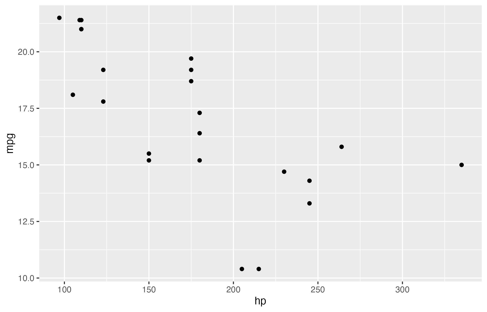

quarto preview
```{r, loading-libraries-and-functions}
#| message: false
#| warning: false
#| include: false

# libraries and functions
library(here)
library(ggplot2) 
library(dplyr) 
source(here("pages", "project", "src", "functions", "save_plot_as_png.R"))
```


```{r, getting-data}
#| message: false
#| warning: false
#| include: false

# Call script to read/clean/wrangle and write data for later use 
# if cleaning is not required remove this source() call and ensure
# that you adjust your {here} path to read in the raw data from 
# pages/project/data/ (not the cleaned sub-directory)
#
# If you are using an API call for accessing your data, your 
# data_cleaning.R script would involve accessing the data through
# the api and then saving it locally for reproducibility (see project
# handout). All data are required to be saved as .Rds files for 
# preserve space and to maintain data types (which is not true for 
# .csv files).

source(here("pages", "project", "src", "data", "data_cleaning.R"))

# read data/cleaned data (produced from the above cleaning script)
mtcars <- readRDS(here("pages", "project", "data", "cleaned", "mtcars_cleaned.Rds"))
```


```{r, plot-mpg-by-hp}
#| echo: false
#| message: false
#| warning: false

# create plot
# recommendation: always save plots as png so that you have an easily accessible
# plot file available for other purpose (slide, sharing, etc.); extracting plots
# from a webpage manually is more difficult 
# then embed the png into the webpage 

p <- 
  mtcars |>
  ggplot(mapping = aes(
     x = hp, 
     y = mpg
     )) +
  geom_point()
```


```{r, saveplot-mpg}
#| message: false
#| warning: false
#| include: false

# save the plot as a .png file using the save_plot_as_png()
save_plot_as_png(
  plot = p,
  file_name = "mpg-by-hp.png"
)
```

## Plot Header

{width=80% fig-alt="This is alt-text for describing the plot for screen readers ..."}


## Plot Explanation

Blah, blah, blah ...


```{r, plot-mpg-by-wt-for-cyl}
#| echo: false
#| message: false
#| warning: false

# create plot for subset
p <- 
  mtcars |>
  # get only 6 cylinder cars
  filter(cyl %in% 4:6) |>
  ggplot(mapping = aes(
    x = wt, 
    y = mpg
    )) +
  geom_point()
```

<!-- SAVE PLOT AS PNG -->

```{r, saveplot-cyl-subset}
#| message: false
#| warning: false
#| include: false

# save the plot as a .png file using the save_plot_as_png()
save_plot_as_png(
  plot = p,
  file_name = "mpg-by-wt-for-cyl.png"
)
```


